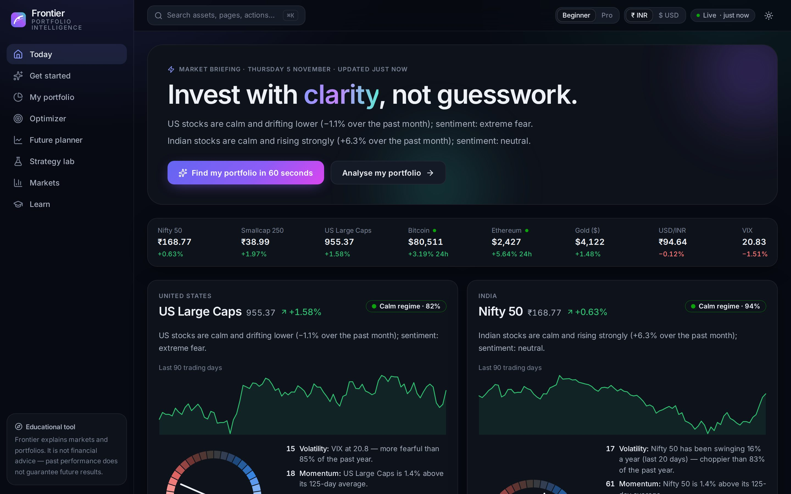
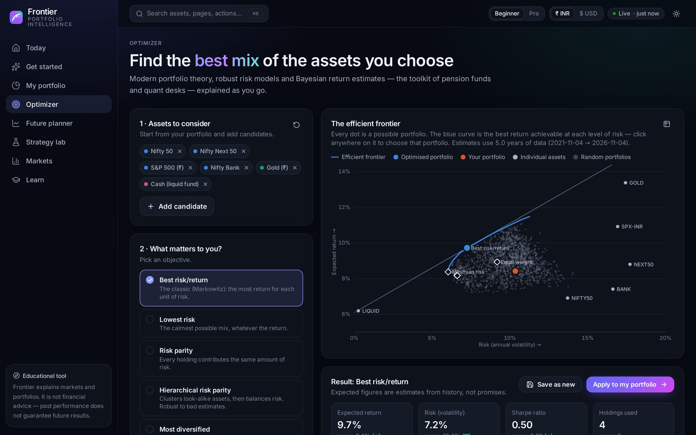
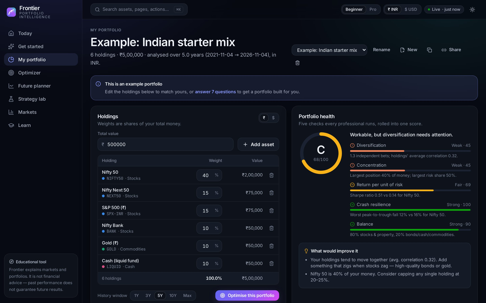
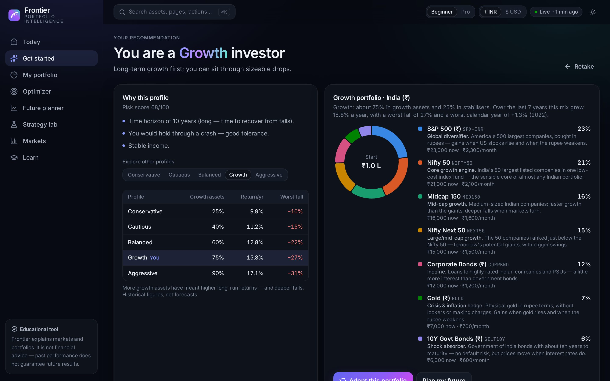
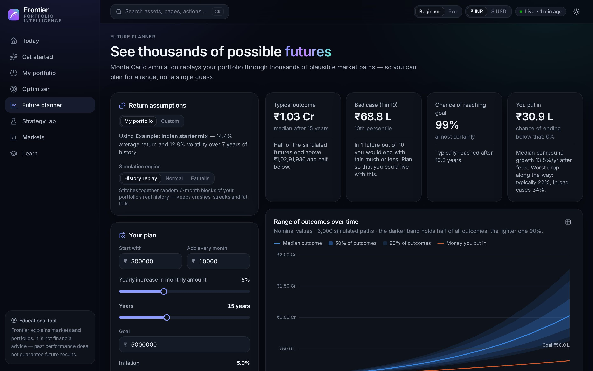
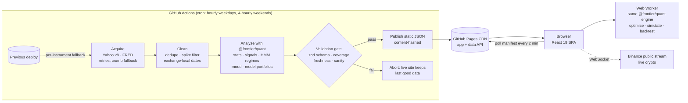

<div align="center">


# Frontier — Portfolio Intelligence

**A quant-grade portfolio manager & optimizer that explains itself in plain English.**
Live market data · autonomous refresh · runs entirely in your browser · zero servers, zero cost.

[**▶ Open the live app**](https://bhang-ux.github.io/frontier-portfolio/) ·
[Interview guide (PDF)](docs/Interview_Guide.pdf) ·
[How it works](#how-it-works)

[](https://github.com/Bhang-ux/frontier-portfolio/actions/workflows/deploy.yml)
[](https://github.com/Bhang-ux/frontier-portfolio/actions/workflows/ci.yml)
[](https://github.com/Bhang-ux/frontier-portfolio/actions/workflows/codeql.yml)




</div>

---

## What it does

Frontier gives a complete beginner the toolkit of a quant desk — and tells them, in plain language, **what to invest in and why**.

|                        |                                                                                                                                                                                                                                                                                                                                                                                                                                       |
| ---------------------- | ------------------------------------------------------------------------------------------------------------------------------------------------------------------------------------------------------------------------------------------------------------------------------------------------------------------------------------------------------------------------------------------------------------------------------------- |
| 🧭 **Get started**     | 7 questions → a risk profile that separates _tolerance_ from _capacity_ (with safety caps) → a forecast-free model portfolio of low-cost ETFs (India ₹ or US $), a Monte Carlo projection of _your_ SIP, and “what could go wrong” in real money.                                                                                                                                                                                     |
| 📊 **My portfolio**    | Health score (A–F) with concrete fixes · annual return, volatility, Sharpe, drawdowns, VaR/CVaR, beta, effective number of bets — each with a one-sentence explanation · money-vs-risk decomposition · HRP-ordered correlation heatmap · return distribution with fat-tail check · rolling statistics · monthly-returns calendar · historical crisis replays (GFC → 2025 tariff shock) · what-if shocks · multi-factor exposures.     |
| 🎯 **Optimizer**       | Max Sharpe, min variance, risk parity, HRP, max diversification, min CVaR, target return/risk, equal weight · per-asset & asset-class guard-rails · Ledoit–Wolf / EWMA / RMT-denoised risk models · Bayes–Stein, CAPM, EWMA or equilibrium returns · **Black–Litterman views** · interactive efficient frontier (click to pick a portfolio) · reasons for every change · executable trade list · **walk-forward out-of-sample test**. |
| 🔮 **Future planner**  | Monte Carlo with history bootstrap (stationary block), normal or fat-tailed returns; SIP step-ups, fees, inflation (real vs nominal), retirement withdrawals; probability of reaching your goal, of loss, of running out.                                                                                                                                                                                                             |
| 🧪 **Strategy lab**    | Rebalancing rules compared after costs; a walk-forward tournament of allocation methods on your own holdings.                                                                                                                                                                                                                                                                                                                         |
| 🌍 **Today & Markets** | Plain-English market briefing, live crypto stream, HMM market regimes (calm vs turbulent), a transparent Market Mood gauge, breadth, a market map, cross-asset scoreboard and a 100-instrument screener with trend & momentum scores.                                                                                                                                                                                                 |

Every chart is accessible (keyboard crosshair, table view, colour-blind-safe validated palette) and works in light and dark themes, on desktop and mobile. **Beginner / Pro** mode switches between explanations and density.

<p>


</p>
<p>


</p>

## How it works



- **Stateless ETL, static API.** Each scheduled run rebuilds the entire dataset from source, so there is no database to corrupt or migrate. Output is JSON on the same CDN as the app; the browser polls a ~5 KB manifest and only downloads files whose content hash changed.
- **One quant engine, two runtimes.** `packages/quant` is pure TypeScript with zero runtime dependencies. The pipeline (Node) and the app (Web Worker) run _the same code_, so a number on the dashboard can never disagree with the analysis page.
- **Your data stays yours.** Portfolios live in `localStorage`; sharing encodes a portfolio into the URL hash. No accounts, no tracking, no backend.
- **Fails safe.** Upstream flake → previous copy of that instrument; schema/freshness failure → no deploy; site → still the last good build.

### The quant engine (`packages/quant`)

| Area             | Implementation                                                                                                                                                                                                                       |
| ---------------- | ------------------------------------------------------------------------------------------------------------------------------------------------------------------------------------------------------------------------------------ |
| Linear algebra   | Cholesky with jitter fallback, cyclic Jacobi eigen-decomposition, nearest-PSD repair                                                                                                                                                 |
| Risk models      | Sample, EWMA (RiskMetrics), **Ledoit–Wolf** (identity & constant-correlation), Marchenko–Pastur denoising                                                                                                                            |
| Expected returns | Historical, EWMA, CAPM, **Bayes–Stein** (Jorion 1986), equilibrium, **Black–Litterman** (He–Litterman & Idzorek Ω)                                                                                                                   |
| Optimisation     | Monotone FISTA over **exact** capped-simplex and disjoint-group projections; frontier tracing; tangency by golden-section along the λ-path; risk parity (Spinu CCD); **HRP** (López de Prado); smoothed Rockafellar–Uryasev **CVaR** |
| Simulation       | GBM (exact moment matching), Student-t, **stationary block bootstrap**; contributions, fees, inflation, withdrawals                                                                                                                  |
| Evaluation       | Rebalancing backtests with costs, **walk-forward** out-of-sample tests                                                                                                                                                               |
| Market structure | **Gaussian HMM** (Baum–Welch, Viterbi, filtered probabilities), factor regressions, stress tests with proxies                                                                                                                        |
| Explainability   | Deterministic natural-language generation for every metric                                                                                                                                                                           |

Validated by **golden tests** against scikit-learn, PyPortfolioOpt, CVXPY (Clarabel/HiGHS) and SciPy — exact to 1e-12 where the algorithm is deterministic. CI re-derives the fixtures in Python on every push.

## Engineering decisions (short version)

| Decision                                     | Why                                                                                                                        |
| -------------------------------------------- | -------------------------------------------------------------------------------------------------------------------------- |
| GitHub Pages + Actions                       | Truly free, permanent, CDN-backed, no cold starts; the scheduler, CI and hosting live next to the code.                    |
| Static data API instead of a server          | Nothing to scale, patch or pay for; reads are CDN hits; content hashes give perfect cache behaviour.                       |
| TypeScript quant engine (not Python/Pyodide) | Same code in pipeline and browser, ~40 KB instead of a 10 MB runtime, unit-tested once; Python is kept for _verification_. |
| First-order solver instead of a QP library   | Exact projections make FISTA simple, dependency-free and fast; verified against interior-point solvers.                    |
| Forecast-free model portfolios               | Expected returns are the noisiest input; beginners get allocation by risk budget, not last decade's winners.               |
| Web Worker + React Query                     | Heavy maths off the main thread; worker calls are cached and de-duplicated like network requests.                          |

The full reasoning, trade-offs and 20 interview questions are in [`docs/Interview_Guide.pdf`](docs/Interview_Guide.pdf).

## Run it locally

```bash
npm ci
npm run data:synthetic   # offline demo dataset (clearly flagged in the UI)
npm run dev              # http://localhost:5173/frontier-portfolio/
```

With internet access, `npm run data` fetches **live** data instead.

```bash
npm run verify           # typecheck + lint + all unit/golden/pipeline tests
npm run build && npx playwright test   # production build + end-to-end tests
python tools/reference/generate_fixtures.py   # regenerate golden fixtures (needs tools/reference/requirements.txt)
npm run guide            # rebuild docs/Interview_Guide.pdf
```

## Project layout

```
packages/quant       zero-dependency quant engine (+ golden & unit tests)
packages/contracts   typed data contracts + history codec shared by pipeline & web
pipeline             scheduled ETL: sources, analytics, validation, publishing
web                  React 19 + Vite 7 + Tailwind 4 app, Web Worker, charts
e2e                  Playwright journeys (desktop + mobile)
tools                Python reference generator, screenshot tool
.github/workflows    CI · data refresh & deploy · CodeQL · screenshots · keepalive
docs                 interview guide (PDF + generator), screenshots
```

## Testing

- **87 unit & golden tests** (Vitest): numerical kernels, every optimiser objective vs CVXPY, Ledoit–Wolf vs scikit-learn, HRP & Black–Litterman vs PyPortfolioOpt, Monte Carlo vs closed forms, HMM regime recovery, parsers with recorded API fixtures, the validation gate, the risk questionnaire.
- **26 end-to-end tests** (Playwright, desktop + mobile): every route, the full beginner journey, optimiser, command palette, theme, share links.
- **Live smoke test** after each deploy: the CDN serves the manifest just built and deep links return 200.

## Disclaimer

Frontier is an educational project. It is **not** investment, tax or legal advice, and nothing in it is a recommendation to buy or sell any security. Market data may be delayed or inaccurate. Past performance does not guarantee future results.

## License

[MIT](LICENSE)
